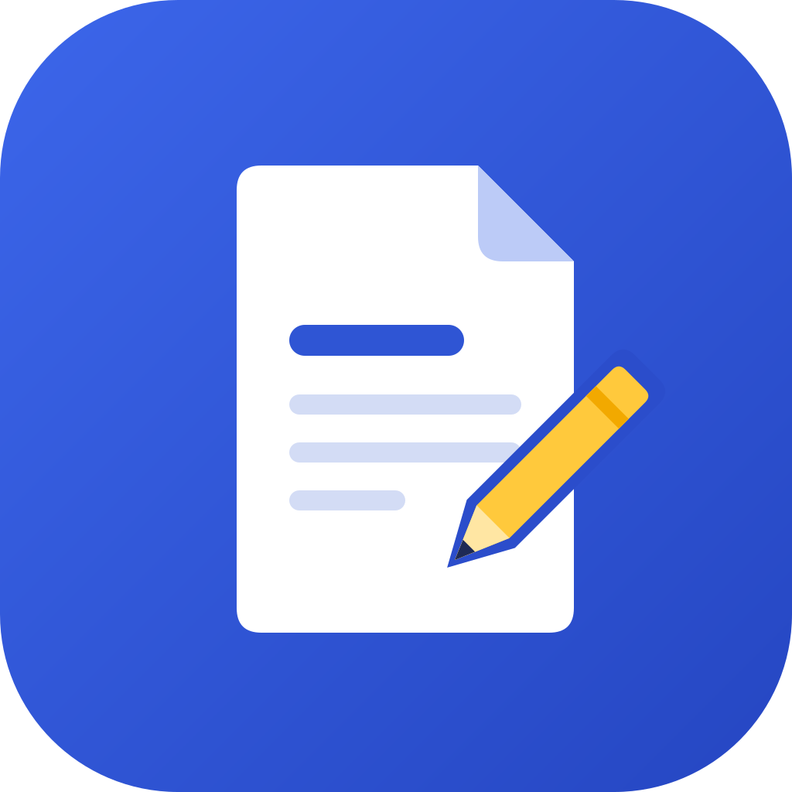
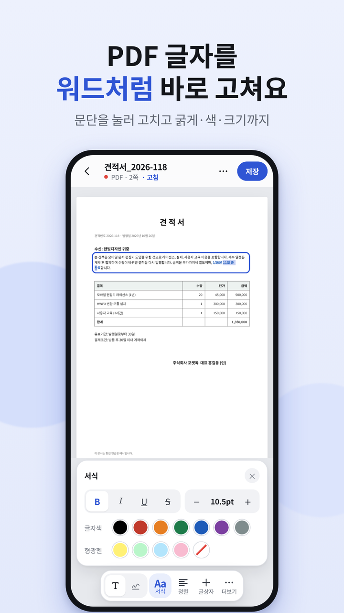
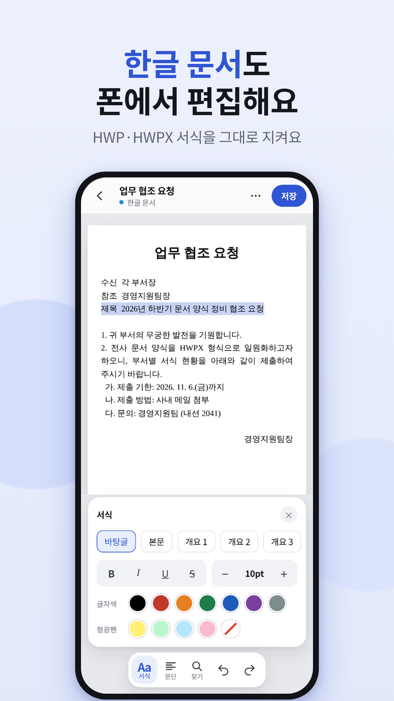
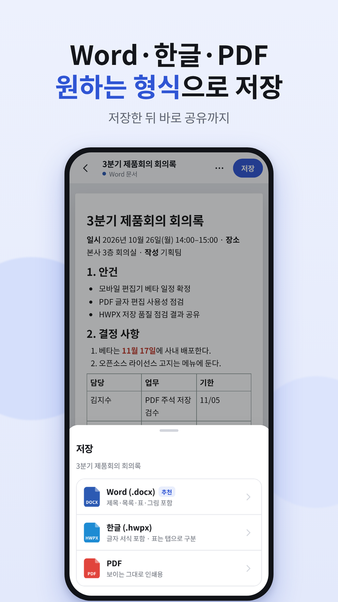
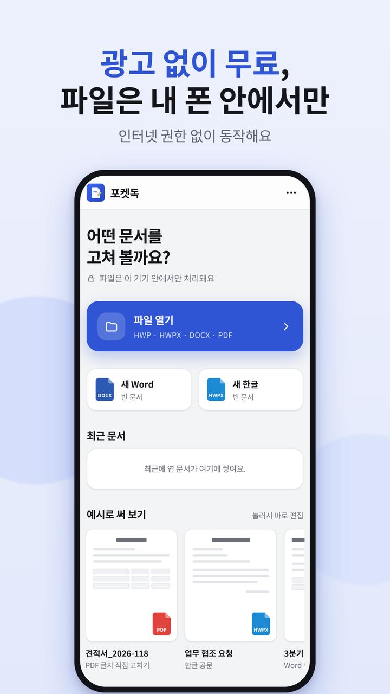

<div align="center">



# 포켓독 PocketDoc

**한글·워드·PDF를 폰에서 바로 고치는 무료 편집기**


### [📥 앱 내려받기 (APK)](https://likesong1234.github.io/pocketdoc/app-release.apk)

[다운로드 페이지](https://likesong1234.github.io/pocketdoc/) · [개인정보처리방침](https://likesong1234.github.io/pocketdoc-privacy/)

</div>

---

## 화면

| PDF 글자 편집 | 한글 문서 편집 | 원하는 형식으로 저장 | 첫 화면 |
|:---:|:---:|:---:|:---:|
|  |  |  |  |

## 할 수 있는 것

| 형식 | 열기 | 편집 | 저장 |
|---|:---:|---|---|
| **PDF** | ✅ | 문단을 눌러 워드처럼 글자 수정 · 굵게·기울임·밑줄·색·크기·정렬 · 새 글상자 · 펜·형광펜·화이트아웃 · 쪽 삭제 | PDF |
| **한글 HWPX** | ✅ | 원본 서식을 지키며 글자·문단·스타일 수정 (그림·수식은 그대로) | HWPX · Word · PDF |
| **한글 HWP** | ✅ | 글자와 표를 불러와 수정 | HWPX · Word · PDF |
| **Word DOCX** | ✅ | 제목·목록·표·그림·글자색·형광펜 | Word · HWPX · PDF |

- 찾기·바꾸기, 새 문서 만들기
- 다른 앱(카카오톡, 내 파일 등)에서 **"포켓독으로 열기"**
- 저장한 파일은 `내 파일 › Documents › PocketDoc` 에 보관되고 바로 공유할 수 있어요

## 설치 방법

1. 폰에서 위의 **앱 내려받기**를 누르세요.
2. 받은 `pocketdoc.apk` 를 누르세요.
3. "출처를 알 수 없는 앱" 안내가 나오면 **설정 › 이 출처 허용**을 켜고 **설치**를 누르세요.

> 새 버전이 나오면 같은 방법으로 받아서 덮어 설치하면 돼요.

## 개인정보와 권한

- **인터넷 권한이 없어요.** 문서는 폰 안에서만 처리되고 어디로도 전송되지 않아요.
- 회원가입, 광고, 이용 통계 수집이 없어요.
- 저장소 권한은 Android 10 이하 폰에서 파일을 저장할 때만 써요.

자세한 내용은 [개인정보처리방침](https://likesong1234.github.io/pocketdoc-privacy/)을 보세요.

<details>
<summary><b>앱이 진짜인지 확인하기 (서명 인증서)</b></summary>

공식 포켓독 APK의 서명 인증서 SHA-256 지문이에요. 값이 다르면 다른 사람이 수정한 파일이니 설치하지 마세요.

```
65:3E:6D:5E:49:82:76:C9:09:17:27:EA:F4:D5:CC:DA:F1:0E:6F:B9:A0:FD:6E:83:AA:12:02:D0:28:85:32:EB
```

</details>

<details>
<summary><b>사용한 오픈소스</b></summary>

모두 상업적 이용이 가능한 라이선스예요.

| 구성 요소 | 라이선스 | 용도 |
|---|---|---|
| Capacitor | MIT | 안드로이드 앱 |
| pdf.js | Apache-2.0 | PDF 열기·표시 |
| pdf-lib, @pdf-lib/fontkit | MIT | PDF 저장·글자 쓰기 |
| mammoth.js | BSD-2-Clause | Word 열기 |
| JSZip | MIT | HWPX·DOCX 처리 |
| html2canvas | MIT | PDF 내보내기 |
| cfb | Apache-2.0 | HWP 읽기 |
| pako | MIT · Zlib | HWP 압축 풀기 |
| python-hwpx 템플릿 | Apache-2.0 | 새 한글 문서 |
| Noto Sans KR | OFL-1.1 | 글꼴 |

본 제품은 한글과컴퓨터의 한/글 문서 파일(.hwp) 공개 문서를 참고하여 개발하였습니다.

</details>

---

<div align="center">

문의 · sjn64681@gmail.com

</div>
